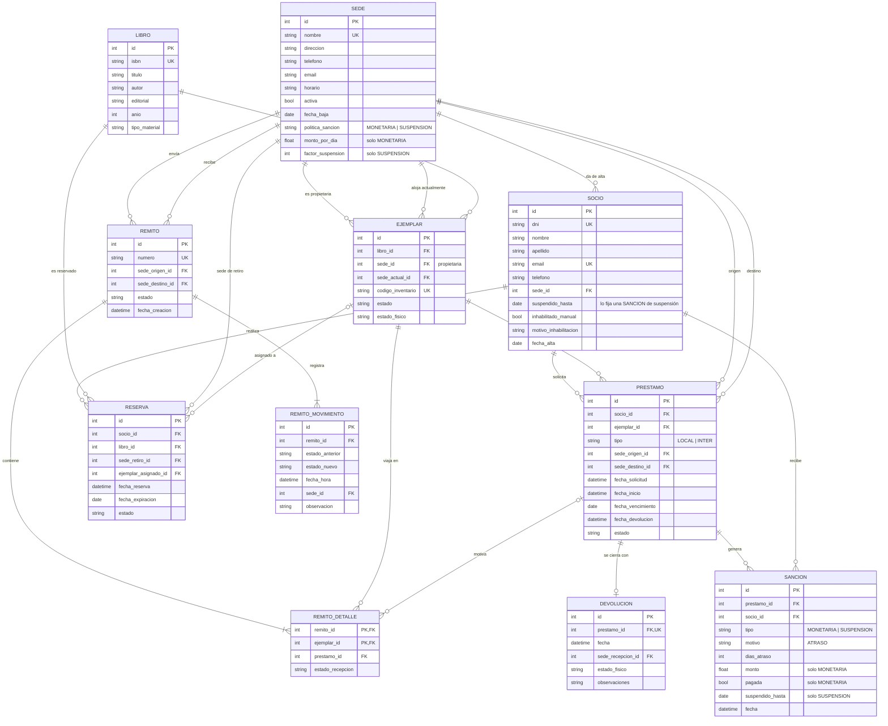

# TP Integrador DAO 2026 — Sistema de Préstamos Interbibliotecarios

Trabajo práctico integrador de **Desarrollo de Aplicaciones con Objetos** (Ingeniería en Sistemas de Información, UTN FRC), Tema 1.

Una red de bibliotecas públicas necesita administrar sus sedes, socios, catálogo y ejemplares, préstamos locales e interbibliotecarios, envíos de ejemplares entre sedes (con remito y trazabilidad), reservas y devoluciones.

## Stack y decisiones técnicas

- **Python 3.10+** y **SQLite** mediante el módulo estándar `sqlite3`.
- **Sin ORM.** No usar SQLAlchemy. El acceso a datos se hace con SQL explícito dentro de clases repositorio (DAO), siguiendo el material de la cátedra.
- **Interfaz gráfica con Flet**, siguiendo la guía de Flet de la cátedra: una clase convencional por pantalla con `build()`, sin `ft.UserControl`, y sin SQL ni reglas de negocio en los eventos.
- **Reportes con ReportLab (PDF) y Matplotlib (gráficos)**, más exportación a CSV con el módulo estándar `csv`.
- Dependencias externas (`requirements.txt`): `flet`, `reportlab`, `matplotlib`. La capa de datos no usa ninguna.

### Arquitectura en capas

```
biblioteca/
├── modelo/        # Entidades y patrones. Python puro, sin imports de sqlite3.
├── datos/         # Conexión, schema.sql, seed y un DAO por entidad principal.
├── servicios/     # Casos de uso, validaciones que cruzan entidades, transacciones y ServicioReportes.
├── reportes/      # Exportadores a PDF (ReportLab + Matplotlib) y CSV. Reciben datos, no consultan la base.
└── presentacion/  # Flet: una clase por pantalla, con build().
```

Reglas:
- `presentacion` solo llama a `servicios`.
- `servicios` usa `modelo` y `datos`.
- `modelo` no conoce la base de datos. Las entidades se pueden probar sin SQLite.
- Los DAO (repositorios) son los únicos que escriben SQL y mapean filas (`sqlite3.Row`) a objetos. Reciben la conexión en el constructor; el servicio abre la conexión y hace `commit()` o `rollback()`.
- Los reportes se escriben como SQL directo en `ServicioReportes`, que devuelve los datos; la pantalla los muestra en un `ft.DataTable` y los exportadores de `reportes/` generan el PDF o el CSV a partir de esos mismos datos.

### Patrones de diseño (mínimo dos obligatorios)

- **State — ciclo de vida del remito** (`biblioteca/modelo/remito.py`). Cada estado es una clase que decide qué operaciones admite; las inválidas lanzan `TransicionInvalida`. Cada transición agrega un movimiento al historial (`remito_movimiento`). En la base se guarda el código del estado como texto; `RemitoDAO` lo reconstruye con `Remito.estado_desde_codigo(codigo)`.
  - Estados: `EN_PREPARACION → DESPACHADO → EN_TRANSITO (repetible) → RECIBIDO | RECIBIDO_CON_INCIDENCIA | EXTRAVIADO`; además `EN_PREPARACION → ANULADO`.
- **Strategy — sanciones por atraso** (`biblioteca/modelo/sancion.py`). `EstrategiaSancion` con `SancionMonetaria` (monto por día) y `SancionSuspension` (suspende al socio `dias_atraso × factor` días). Cada sede elige su política. Al devolver con atraso se aplica la política de la **sede de origen** del préstamo (`Sede.estrategia_sancion()` → `CalculadoraSancion`).
- **Observer — consecuencias de cada cambio de estado del remito.** `Remito` es el sujeto (`suscribir` / `_notificar`, equivalentes a `attach` / `notify`); `ObservadorRemito.actualizar` equivale a `update`. Observadores concretos en `biblioteca/servicios/observadores.py`: `ActualizadorEjemplares` y `ActualizadorPrestamos`, independientes entre sí, suscriptos por `ServicioRemitos._operar`.
- **No implementado:** Factory para préstamos local/interbibliotecario (opcional).

## Material de la cátedra

Seguir el estilo y la nomenclatura de la cátedra. Los resúmenes se cargan en cada sesión:

- @docs/apuntes/acceso-datos.md — sqlite3, transacciones, manejo de errores y patrón DAO, con los ajustes que usa este TP (DAO que devuelven entidades y reciben la conexión del servicio).
- @docs/apuntes/patrones.md — State, Strategy, Observer, Factory y Singleton tal como los presenta la cátedra, y dónde se aplica cada uno en el TP.
- @docs/apuntes/interfaz-reportes.md — Flet (elegido) y Tkinter como alternativa; reportes con ReportLab, Matplotlib y CSV, y cómo se reparten entre las capas.

Los PDFs originales están en `docs/apuntes/` (no versionados). Consultarlos solo si un resumen no alcanza.

## Requisitos de la consigna

### Procesos obligatorios
1. Administrar sedes (dirección, contacto, horarios, estado activa/baja).
2. Administrar socios.
3. Administrar catálogo de libros y ejemplares físicos, indicando la sede de cada ejemplar.
4. Registrar solicitudes de préstamo local e interbibliotecario (sede origen y destino).
5. Empaquetar, despachar y recibir ejemplares con remito y trazabilidad por estados.
6. Consultar disponibilidad.
7. Gestionar reservas.
8. Registrar devoluciones y el estado físico del material devuelto.

### Opcionales elegidos
- Revisión de estado de recepción (extravío, daño, destrucción): cubierto por los estados del remito y `remito_detalle.estado_recepcion`.

### Validaciones de negocio
- No prestar ejemplares no disponibles.
- No prestar a socios inhabilitados. Un socio está inhabilitado si `suspendido_hasta > hoy` o `inhabilitado_manual = 1`. Esta condición se calcula; implementarla como método de `Socio`.
- Controlar fechas de vencimiento de préstamos.
- Mantener la trazabilidad del remito en todo el trayecto.
- Evitar duplicados (socios por DNI, libros por ISBN, ejemplares por código de inventario).
- No prestar ejemplares que no pertenezcan a la sede de origen del préstamo (`ejemplar.sede_id`, no `sede_actual_id`).
- No iniciar préstamos, reservas ni envíos hacia o desde una sede dada de baja.

### Reportes (al menos cuatro no triviales, en pantalla y exportables a PDF y CSV)
- Préstamos activos y material en tránsito.
- Préstamos vencidos y sanciones acumuladas.
- Libros más solicitados para préstamos inter-sedes.
- Disponibilidad de catálogo por sede.
- Tasa de envíos exitosos e incidencias.
- Movimiento de ejemplares entre sedes y tiempo promedio de tránsito (desde `remito_movimiento`).

## Modelo de datos



### Valores de los campos de estado

| Tabla.campo | Valores |
|---|---|
| `ejemplar.estado` | DISPONIBLE, RESERVADO, PRESTADO, EN_TRANSITO, EXTRAVIADO, BAJA |
| `ejemplar.estado_fisico`, `devolucion.estado_fisico` | BUENO, REGULAR, DANIADO, DESTRUIDO |
| `libro.tipo_material` | LIBRO, REVISTA, MAPA, MULTIMEDIA, OTRO |
| `prestamo.estado` | SOLICITADO, EN_TRANSITO, LISTO_PARA_RETIRO, ACTIVO, VENCIDO, DEVUELTO, CANCELADO |
| `reserva.estado` | PENDIENTE, ASIGNADA, CUMPLIDA, CANCELADA, EXPIRADA |
| `remito.estado` | EN_PREPARACION, DESPACHADO, EN_TRANSITO, RECIBIDO, RECIBIDO_CON_INCIDENCIA, EXTRAVIADO, ANULADO |
| `remito_detalle.estado_recepcion` | OK, DANIADO, FALTANTE, DESTRUIDO |

### Reglas de integridad que van en la base

- `PRAGMA foreign_keys = ON` en **cada** conexión (SQLite lo desactiva por defecto).
- Préstamo LOCAL: origen = destino. INTER: origen ≠ destino.
- Un solo préstamo abierto por ejemplar (índice único parcial sobre los estados abiertos).
- Una sola reserva vigente por socio y libro.
- Remito: origen ≠ destino.
- Sede: si la política es MONETARIA requiere `monto_por_dia`; si es SUSPENSION, `factor_suspension`. Activa sin `fecha_baja`; dada de baja con `fecha_baja`.
- Sanción MONETARIA: `monto` y `pagada` no nulos, `suspendido_hasta` nulo. SUSPENSION: al revés.
- Socio con `inhabilitado_manual = 1` requiere `motivo_inhabilitacion`.
- Fechas guardadas como texto ISO 8601 (`YYYY-MM-DD` o `YYYY-MM-DD HH:MM:SS`).

## Estado del proyecto

Implementado completo: modelo, esquema, DAO, servicios, 6 reportes con exportación PDF/CSV, interfaz Flet y datos de prueba. Ver `README.md` para comandos, reglas de negocio definidas y estructura.

La interfaz tiene **dos modos** que comparten servicios, modelo y base. `main()` abre `presentacion/ingreso.py` (`PantallaIngreso`), que elige entre:
- **Personal:** `AplicacionBiblioteca` (`presentacion/app.py`) con las pantallas de `presentacion/pantallas/` (inicio, sedes, socios, catálogo, préstamos y devoluciones, remitos, reservas, reportes).
- **Socio** (ingreso solo por DNI, sin contraseña): `AplicacionSocio` (`presentacion/app_socio.py`) con las pantallas de `presentacion/pantallas_socio/` (catálogo, mis préstamos, mis reservas, mi situación). Solo usan `ServicioConsultaSocio` (`servicios/consulta_socio.py`, `servicios.consulta_socio`) y las lecturas `catalogo.listar_libros` / `catalogo.disponibilidad`. Cada método de `ServicioConsultaSocio` recibe el `socio_id` y nunca devuelve datos de otro socio; reservar y cancelar delegan en `ServicioReservas`.

Las dos aplicaciones heredan de `AplicacionBase` (`presentacion/app_base.py`): navegación (`armar`, `mostrar`), `notificar`, `ejecutar`, `ejecutar_y_refrescar`, `dialogo` y `confirmar`. Para cambiar de modo se reemplaza el contenido de la página (`ingreso.cambiar_contenido`).

- Base y datos de prueba: `python -m biblioteca.datos.seed --reiniciar`
- Aplicación: `python main.py`
- Pruebas: `python -m pytest` (modelo, restricciones del esquema, servicios, reportes e interfaz de ambos modos con la página falsa de `tests/utilidades.py`)

Cómo trabajar sobre el código existente:

- **Reloj:** los servicios no llaman a `datetime.now()`; usan `self.ahora()` (inyectable con `RelojManual` en pruebas y seed). Mantenerlo así.
- **Operaciones que cruzan servicios** (empaquetar en un remito, asignar reservas, decidir qué pasa con un ejemplar liberado) están en `servicios/operaciones.py` y reciben los `Repositorios` de la transacción en curso.
- **Seed:** se carga a través de los servicios con un reloj que avanza; si se agrega una regla de negocio, el seed tiene que seguir pasando. `test_seed_y_reportes` lo verifica.
- **Interfaz:** cada pantalla en `presentacion/pantallas/` y `presentacion/pantallas_socio/` es una clase con `build()` y `refrescar()`; los formularios se abren con `app.dialogo(...)` y los errores de negocio (`ErrorNegocio`) se muestran dentro del formulario sin cerrarlo. Los diálogos de solo lectura (detalle de una devolución, sanciones de un socio) usan `app.mostrar_detalle(titulo, controles)`, que tiene un único botón "Cerrar" y devuelve un `ejecutar(...)` para acciones disparadas desde el diálogo (su aviso se muestra dentro del diálogo, no en un SnackBar, que quedaría tapado por el modal). Después de un evento originado en un diálogo hay que llamar a `page.update()` (lo hace `app.dialogo`).
- **Flet 1.x:** `ft.run`, `ft.Button(content=...)`, `ft.DropdownOption`, `Dropdown.on_select`, `page.show_dialog` / `page.pop_dialog`. No usar APIs de Flet 0.x (`ft.app`, `ElevatedButton(text=...)`, `page.open`).

## Convenciones

- Código, nombres de clases, tablas, columnas y mensajes en **español**, sin tildes ni ñ en identificadores (`DANIADO`, `anio`).
- Tipado con anotaciones (`int | None`, `list[Ejemplar]`).
- Consultas siempre parametrizadas (`?`), nunca con f-strings.
- Sin dependencias externas para la capa de datos.
