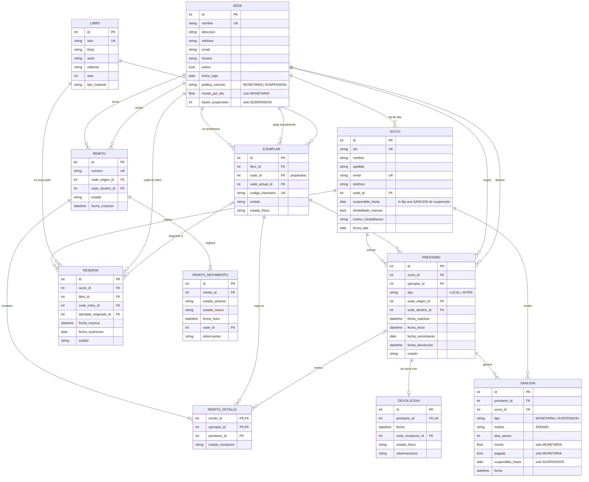
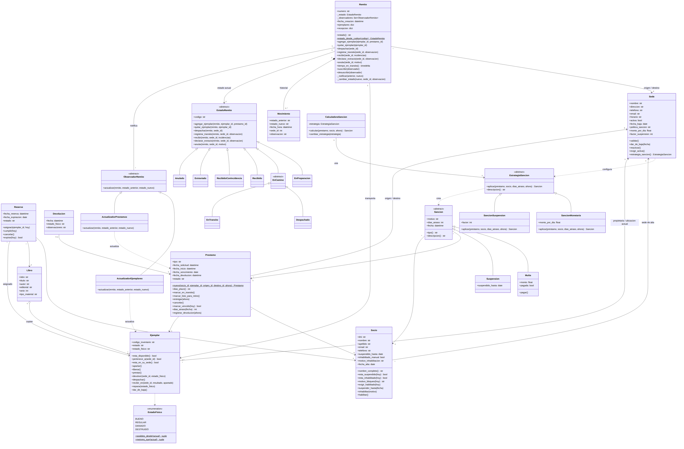
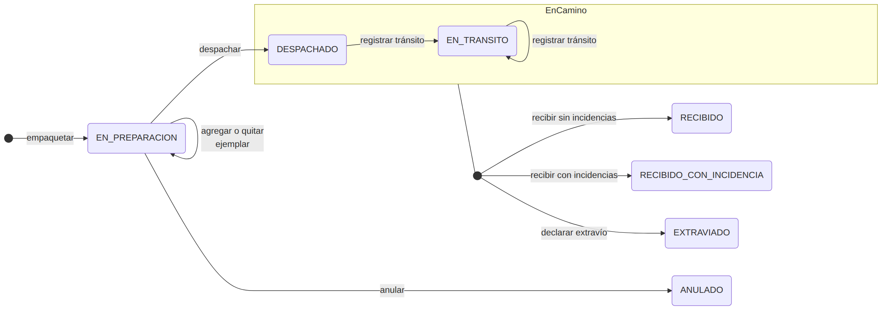

# Preguntas de la defensa — TP Préstamos Interbibliotecarios

Nov 11, 2026 · @Federico

Cinco bloques de preguntas en el orden de la defensa: dominio, patrones, transacciones, ciclo de vida y reportes. Cada pregunta trae la respuesta para decir en voz alta y dónde está en el código para mostrarla.

## Diagramas

### Diagrama entidad-relación

Las once tablas con sus claves y relaciones (`biblioteca/datos/schema.sql`; fuente en `docs/der.mmd`).



### Diagrama de clases del modelo

Las entidades de `biblioteca/modelo/` y los tres patrones: State (remito y sus estados), Observer (observadores del remito) y Strategy (sanciones). Fuente en `docs/diagrama-clases.mmd`.



## 1. Dominio y entidades

### ¿Cuáles son las entidades del sistema?

Once tablas: `sede`, `socio`, `libro`, `ejemplar`, `prestamo`, `reserva`, `remito`, `remito_detalle`, `remito_movimiento`, `devolucion` y `sancion`. En el código, cada una es una clase de `biblioteca/modelo/` (salvo detalle y movimientos, que forman parte del `Remito`).

| Entidad | Qué representa | Clase |
| --- | --- | --- |
| Sede | Una biblioteca de la red, con su política de sanción | `Sede` (`modelo/sede.py`) |
| Socio | Persona habilitada a pedir material | `Socio` (`modelo/socio.py`) |
| Libro | La obra del catálogo (ISBN, título, autor) | `Libro` (`modelo/catalogo.py`) |
| Ejemplar | Cada copia física, con código de inventario | `Ejemplar` (`modelo/catalogo.py`) |
| Préstamo | Local o interbibliotecario, con sede de origen y de retiro | `Prestamo` (`modelo/prestamo.py`) |
| Reserva | Pedido de un título para retirar en una sede | `Reserva` (`modelo/reserva.py`) |
| Remito | Envío de ejemplares entre dos sedes, con historial | `Remito` + `Movimiento` (`modelo/remito.py`) |
| Devolución | Cierre del préstamo: sede, estado físico, observaciones | `Devolucion` (`modelo/prestamo.py`) |
| Sanción | Multa o suspensión por atraso | `Multa`, `Suspension` (`modelo/sancion.py`) |

### ¿Por qué Libro y Ejemplar son entidades distintas?

Porque el libro es la obra y el ejemplar es la copia física. Un libro tiene muchos ejemplares, y cada ejemplar pertenece a una sede y tiene su propio estado. Se presta un ejemplar (el socio se lleva una copia concreta) y se reserva un libro (cualquier copia que se libere). El remito transporta ejemplares. La consigna lo pide explícitamente: "ejemplares físicos, indicando la sede a la que pertenece cada ejemplar".

### ¿Por qué el ejemplar tiene dos sedes?

`sede_id` es la sede propietaria y no cambia nunca. `sede_actual_id` es dónde está físicamente y cambia con cada envío. La validación "no prestar ejemplares que no pertenezcan a la sede de origen" usa la propietaria; la disponibilidad usa las dos.

```python
# modelo/catalogo.py — Ejemplar
def pertenece_a(self, sede_id: int) -> bool:
    return self.sede_id == sede_id

def esta_en_su_sede(self) -> bool:
    return self.sede_actual_id == self.sede_id
```

Ejemplo para contar: un ejemplar de la Sede Norte que se devuelve en Central queda físicamente en Central, disponible, esperando el remito de retorno. Central no puede prestarlo porque no le pertenece, y Norte tampoco porque no está en su sede.

### ¿Por qué préstamo local e interbibliotecario están en la misma tabla?

Porque son el mismo concepto con una diferencia: en el local la sede de origen y la de retiro son la misma. La columna `tipo` los distingue y un `CHECK` de la base lo garantiza. El comportamiento distinto (plazo de 14 o 21 días, estado inicial, si requiere envío) está en `Prestamo`.

### ¿Por qué el remito es una entidad separada del préstamo?

Porque un remito puede llevar varios ejemplares de distintos préstamos, y también ejemplares que vuelven a su sede sin ningún préstamo (el remito de retorno). Por eso `remito_detalle.prestamo_id` admite nulo. Además, el remito tiene su propio ciclo de vida y su historial (`remito_movimiento`), que es lo que da la trazabilidad.

### ¿Cómo se sabe si un socio está inhabilitado?

No es una columna: se calcula. Un socio está inhabilitado si tiene una suspensión vigente o una inhabilitación manual (con motivo obligatorio).

```python
# modelo/socio.py
def esta_suspendido(self, hoy: date) -> bool:
    return self.suspendido_hasta is not None and self.suspendido_hasta > hoy

def esta_inhabilitado(self, hoy: date) -> bool:
    return self.inhabilitado_manual or self.esta_suspendido(hoy)
```

Si fuera un campo `habilitado`, alguien tendría que acordarse de volver a habilitarlo cuando vence la suspensión.

### ¿Qué validaciones hace la base y cuáles el código?

La base garantiza lo que no puede romperse nunca, aunque alguien escriba SQL a mano: claves foráneas (con `PRAGMA foreign_keys = ON` en cada conexión), unicidad de DNI, ISBN y código de inventario, un solo préstamo abierto por ejemplar y una sola reserva vigente por socio y libro (índices únicos parciales), y los `CHECK` de coherencia (préstamo local con la misma sede, sanción monetaria con monto, sede con el parámetro de su política).

El código valida las reglas que dependen del contexto o de la fecha: socio habilitado, ejemplar disponible y en su sede, sedes activas, máximo de 3 préstamos abiertos (para pedir otro préstamo y también para reservar), plazo de retiro de una reserva, y que una sede no se dé de baja con préstamos, reservas o ejemplares pendientes. Cuando la base rechaza algo, el servicio traduce el `IntegrityError` a un mensaje para el usuario (ver Transacciones).

### ¿Las entidades conocen la base de datos?

No. `modelo/` es Python puro, sin `import sqlite3`. Las pruebas de `tests/test_modelo.py` usan las clases sin base. Los DAO son los únicos que traducen entre filas y objetos.

## 2. Patrones de diseño

Tres patrones de comportamiento (State, Strategy y Observer) y uno de acceso a datos (DAO). Los dos obligatorios son State y Strategy.

| Patrón | Dónde | Qué resuelve |
| --- | --- | --- |
| State | `modelo/remito.py` | Qué operaciones admite el remito según su estado |
| Strategy | `modelo/sancion.py` | Cómo se sanciona un atraso (multa o suspensión) |
| Observer | `modelo/remito.py` + `servicios/observadores.py` | Qué pasa con ejemplares y préstamos cuando el remito cambia de estado |
| DAO | `datos/*_dao.py` | Encapsular el SQL y traducir filas a objetos |

### State: ¿cómo está implementado?

Tres roles, igual que en el material de la cátedra:

- **Contexto:** `Remito`. Guarda una referencia al objeto estado (`self._estado`), no un texto, y delega cada operación.
- **Estado abstracto:** `EstadoRemito`. Por defecto rechaza todas las operaciones con `TransicionInvalida`.
- **Estados concretos:** `EnPreparacion`, `Despachado`, `EnTransito`, `Recibido`, `RecibidoConIncidencia`, `Extraviado`, `Anulado`. Cada uno habilita solo sus operaciones y decide a qué estado se pasa.

```python
# El contexto delega: no hay ningún if sobre el estado
class Remito:
    def despachar(self, sede_id: int) -> None:
        self._estado.despachar(self, sede_id)

# El estado abstracto rechaza todo por defecto
class EstadoRemito(ABC):
    def despachar(self, remito, sede_id):
        self._rechazar("despachar")

# Un estado concreto habilita la operación y decide la transición
class EnPreparacion(EstadoRemito):
    def despachar(self, remito, sede_id):
        if sede_id != remito.sede_origen_id:
            raise TransicionInvalida("Solo la sede de origen puede despachar el remito")
        if not remito.ejemplares:
            raise TransicionInvalida("No se puede despachar un remito vacío")
        remito._cambiar_estado(Despachado(), sede_id, "Despachado desde la sede de origen")
```

Para no repetir código hay una clase intermedia, `EnCamino`, con lo común a Despachado y EnTransito: registrar tránsito, recibir y declarar extravío. Los cuatro estados finales (`Recibido`, `RecibidoConIncidencia`, `Extraviado`, `Anulado`) no redefinen ninguna operación: heredan de `EstadoRemito` el rechazo de todas y solo declaran su código.

### ¿Cómo se guarda el estado en la base si es un objeto?

Se guarda el código como texto (`remito.estado = 'EN_TRANSITO'`) y el DAO reconstruye el objeto al leer:

```python
# modelo/remito.py
ESTADOS = {cls.codigo: cls for cls in (EnPreparacion, Despachado, EnTransito, Recibido,
                                       RecibidoConIncidencia, Extraviado, Anulado)}

@staticmethod
def estado_desde_codigo(codigo: str) -> EstadoRemito:
    return ESTADOS[codigo]()

# datos/remito_dao.py — obtener_por_id
estado=Remito.estado_desde_codigo(fila["estado"])
```

### ¿Qué hay que hacer para agregar un estado nuevo?

Una clase nueva que herede de `EstadoRemito`, que implemente las operaciones que admite, y agregarla a `ESTADOS` y al `CHECK` de `remito.estado`. Los estados existentes solo cambian si alguno tiene que poder pasar al nuevo. `Remito` no se toca.

### Strategy: ¿cómo está implementado?

- **Estrategia abstracta:** `EstrategiaSancion` con `aplicar(prestamo, socio, dias_atraso, ahora)`.
- **Estrategias concretas:** `SancionMonetaria(monto_por_dia)` devuelve una `Multa`; `SancionSuspension(factor)` suspende al socio `dias × factor` días y devuelve una `Suspension`.
- **Contexto:** `CalculadoraSancion`. Recibe la estrategia, calcula los días de atraso y la invoca sin saber cuál es.

```python
class CalculadoraSancion:
    def __init__(self, estrategia: EstrategiaSancion):
        self.estrategia = estrategia

    def calcular(self, prestamo, socio, ahora):
        dias = prestamo.dias_atraso(ahora.date())
        if dias <= 0:
            return None
        return self.estrategia.aplicar(prestamo, socio, dias, ahora)
```

### ¿Quién elige la estrategia?

La configuración de la sede de origen del préstamo. Es selección externa, como pide la cátedra: la calculadora no decide.

```python
# modelo/sede.py
def estrategia_sancion(self) -> EstrategiaSancion:
    if self.politica_sancion == PoliticaSancion.MONETARIA:
        return SancionMonetaria(self.monto_por_dia)
    return SancionSuspension(self.factor_suspension)

# servicios/prestamos.py — registrar_devolucion
sede_origen = r.sedes.obtener_por_id(prestamo.sede_origen_id)
calculadora = CalculadoraSancion(sede_origen.estrategia_sancion())
sancion = calculadora.calcular(prestamo, socio, ahora)
```

### ¿Por qué la política es de la sede de origen y no de la de devolución?

La sede de origen es la dueña del ejemplar y la que pierde el material mientras está atrasado. Es una regla definida por el equipo; la consigna no la fija.

### ¿Cuál es la diferencia entre State y Strategy si las dos son una jerarquía de clases?

Quién elige la clase concreta. En Strategy la elige alguien de afuera (la sede) y no cambia sola. En State la elige el propio estado: el cliente pide `despachar()` y es `EnPreparacion` el que decide pasar a `Despachado`.

### Observer: ¿cómo está implementado y para qué?

Cuando el remito cambia de estado hay consecuencias en otros objetos: al despacharlo los ejemplares pasan a en tránsito; al recibirlo cambian de sede y el préstamo queda listo para retirar. Si eso estuviera dentro de los estados, el remito tendría que conocer ejemplares, préstamos y DAO.

- **Sujeto:** `Remito`, con `suscribir()` y `_notificar()` (equivalen a `attach()` y `notify()` de la cátedra).
- **Observador:** `ObservadorRemito.actualizar(remito, anterior, nuevo)` (equivale a `update()`).
- **Observadores concretos** (`servicios/observadores.py`): `ActualizadorEjemplares` y `ActualizadorPrestamos`.

```python
# modelo/remito.py — cada transición registra el movimiento y notifica
def _cambiar_estado(self, nuevo, sede_id, observacion):
    anterior = self._estado.codigo
    self.historial.append(Movimiento(anterior, nuevo.codigo, self.reloj(), sede_id, observacion))
    self._estado = nuevo
    self._notificar(anterior, nuevo.codigo)

# servicios/remitos_reservas.py — ServicioRemitos._operar
remito.suscribir(ActualizadorEjemplares(r, self.reloj))
remito.suscribir(ActualizadorPrestamos(r))
operacion(remito, r)
r.remitos.guardar(remito)
```

Los dos observadores son independientes: cada uno modifica solo sus propias entidades (ejemplares o préstamos), así que el orden de suscripción no importa. No se guardan en la base: el servicio los suscribe cada vez que opera.

Al anular el remito de un préstamo, `ActualizadorEjemplares` libera el ejemplar y, si hay reservas pendientes de ese título en la sede, se lo aparta a la más antigua; `ActualizadorPrestamos` cancela el préstamo.

### ¿Por qué hay métodos de los patrones que no se usan (`cambiar_estrategia`, `desuscribir`)?

Completan la interfaz clásica de cada patrón (`setStrategy` y `detach`). Son dos o tres líneas cada uno y muestran que la estrategia se puede cambiar en tiempo de ejecución y que un observador se puede quitar, aunque el flujo actual no lo necesite: la calculadora se crea con la estrategia de la sede y los observadores viven lo que dura una operación.

### DAO: ¿cómo es el acceso a datos?

Una clase DAO por entidad principal (`SedeDAO`, `SocioDAO`, `RemitoDAO`, etc.). Son las únicas que escriben SQL, siempre con parámetros `?`, y devuelven objetos del modelo. Dos diferencias con el ejemplo de la cátedra: reciben la conexión en el constructor en lugar de abrirla en cada método (ver Transacciones), y `RemitoDAO` guarda el remito completo (cabecera, detalle y movimientos nuevos) porque es un agregado.

### ¿Es lo mismo un DAO que un repositorio?

En la práctica cumplen el mismo papel, pero son dos patrones distintos:

| | DAO | Repositorio |
| --- | --- | --- |
| Origen | J2EE: aislar la tecnología de acceso a datos | Fowler y Evans (diseño guiado por el dominio) |
| Se organiza por | Tabla o fuente de datos | Entidad o agregado del dominio |
| Habla en términos de | Persistencia: insertar, actualizar, consultar filas | Una colección de objetos: obtener, agregar, buscar |
| Devuelve | Lo que convenga, incluso filas o diccionarios | Siempre objetos del dominio |

Los de este TP son un híbrido. Tienen de repositorio que devuelven entidades del modelo (`SocioDAO.obtener_por_id` devuelve un `Socio`), que `RemitoDAO` guarda y reconstruye el remito entero como agregado, y que el modelo no sabe nada de SQL. Tienen de DAO que hay uno por tabla principal, que los listados (`listar_resumen`) devuelven diccionarios con columnas de varias tablas, y que hay consultas pensadas para una pantalla o una regla concreta (`contar_pendientes`, `libros_de_sede`). Por eso la clase que los agrupa por transacción se llama `Repositorios`.

Para decir: son DAO, como los llama la cátedra, pero cumplen el rol de repositorio, porque separan el dominio de la base y devuelven objetos del modelo. No son repositorios puros porque los listados devuelven filas armadas para la interfaz, que es más simple que mapear todo a objetos.

### ¿Por qué no usaron Factory o Singleton?

Con State y Strategy están los dos obligatorios, y Observer suma uno más donde resuelve un problema real. Factory para préstamos local e interbibliotecario era posible, pero la diferencia entre los dos es chica (plazo, estado inicial, si requiere envío) y está resuelta en `Prestamo` con el campo `tipo`. Singleton no se usó para la conexión porque una conexión compartida rompería el manejo de transacciones por servicio.

## 3. Transacciones

### ¿Dónde empieza y termina una transacción?

En el servicio. Cada caso de uso abre una conexión, le pasa esa misma conexión a todos los DAO que necesita y al final hace un único `commit()`. Si algo falla en cualquier punto, `rollback()` deshace todo. Está en un solo lugar, `ServicioBase._transaccion`:

```python
# servicios/base.py
@contextmanager
def _transaccion(self) -> Iterator[Repositorios]:
    conexion = obtener_conexion()
    try:
        yield Repositorios(conexion)      # todos los DAO con la misma conexión
        conexion.commit()
    except sqlite3.IntegrityError as error:
        conexion.rollback()
        raise _traducir_error_integridad(error) from error
    except Exception:
        conexion.rollback()
        raise
    finally:
        conexion.close()
```

Y cada método de servicio lo usa así:

```python
with self._transaccion() as r:
    prestamo = r.prestamos.obtener_por_id(prestamo_id)
    ...
    r.prestamos.actualizar(prestamo)
    r.ejemplares.actualizar(ejemplar)
```

### ¿Por qué los DAO reciben la conexión en lugar de abrirla?

En el ejemplo de la cátedra cada método del DAO abre su propia conexión. Así, dos DAO no pueden participar de la misma transacción: si el primero confirma y el segundo falla, la base queda a medias. En este TP casi todas las acciones tocan varias tablas, así que el servicio es el que abre la conexión y decide cuándo confirmar.

### Den un ejemplo de una operación que toca varias tablas

Registrar una devolución con atraso (`ServicioPrestamos.registrar_devolucion`) escribe, en una sola transacción:

1. `prestamo`: pasa a DEVUELTO con la fecha.
2. `ejemplar`: vuelve a disponible (o a baja si está destruido) y cambia su sede actual.
3. `devolucion`: el registro con sede, estado físico y observaciones.
4. `sancion`: la multa o la suspensión.
5. `socio`: la fecha de suspensión, si la política es suspender.
6. `remito`, `remito_detalle` y `remito_movimiento`: si el ejemplar se devolvió en otra sede, el remito de retorno.

Si cualquier paso falla, por ejemplo el último, no queda nada de los anteriores.

### ¿Y la recepción de un remito con los observadores?

También es una sola transacción. `ServicioRemitos._operar` abre la conexión, se la pasa a los observadores y guarda el remito al final. Los cambios que hacen `ActualizadorEjemplares` y `ActualizadorPrestamos` se confirman junto con el nuevo estado del remito, o no se confirma ninguno.

### ¿Qué pasa cuando la base rechaza un dato?

SQLite lanza `sqlite3.IntegrityError`. `_transaccion` deshace la transacción y lo traduce a `ErrorNegocio` con un mensaje para el usuario, que la interfaz muestra sin cerrar el formulario:

```python
_MENSAJES_UNICIDAD = {
    "socio.dni": "Ya existe un socio con ese DNI",
    "libro.isbn": "Ya existe un libro con ese ISBN",
    "reserva.socio_id": "El socio ya tiene una reserva vigente de ese libro",
    ...
}
```

### ¿Cómo se aseguran de que se respeten las claves foráneas?

SQLite las ignora salvo que se activen en cada conexión. `obtener_conexion()` ejecuta `PRAGMA foreign_keys = ON` siempre, y una prueba verifica que quede activo.

### ¿Por qué no usaron `with sqlite3.connect(...) as cx`?

Porque ese `with` hace commit o rollback al salir pero no cierra la conexión. El context manager propio hace las tres cosas y además traduce los errores.

### ¿Cómo prueban las transacciones si dependen de la fecha?

Los servicios nunca llaman a `datetime.now()`: usan `self.ahora()`, que viene de un objeto `Reloj`. En las pruebas y en el seed se usa `RelojManual`, que se puede adelantar (`reloj.avanzar(days=24)`) para simular vencimientos y atrasos.

### ¿Qué cubren los datos de prueba?

`python -m biblioteca.datos.seed --reiniciar` simula 70 días de actividad a través de los servicios, así que cada dato pasó por las mismas validaciones que en la aplicación. Cubre todos los valores de cada campo de estado: préstamos en todos sus estados (incluidos vencidos de sedes con multa y con suspensión), reservas pendientes, asignadas, cumplidas, canceladas y expiradas, remitos en todos sus estados y con todos los resultados de recepción, ejemplares dañados, destruidos y reparados, devoluciones en otra sede con su remito de retorno, multas pagadas e impagas, suspensiones vigentes y cumplidas, un socio inhabilitado, uno en el límite de préstamos y uno sin actividad, y los cinco tipos de material. `test_seed_y_reportes` verifica que la carga siga funcionando con cada regla nueva.

## 4. Ciclo de vida

Cuatro entidades tienen estados: el remito (con el patrón State), el préstamo, el ejemplar y la reserva. Los tres últimos tienen transiciones simples y las controlan sus propios métodos, que validan el estado de partida.

| Entidad | Estados | Dónde |
| --- | --- | --- |
| Remito | En preparación → Despachado → En tránsito (repetible) → Recibido / Recibido con incidencia / Extraviado; En preparación → Anulado | `modelo/remito.py` |
| Préstamo | Solicitado → En tránsito → Listo para retiro → Activo → Vencido → Devuelto; Cancelado desde los tres primeros | `modelo/prestamo.py` |
| Ejemplar | Disponible, Reservado (apartado), Prestado, En tránsito, Extraviado, Baja | `modelo/catalogo.py` |
| Reserva | Pendiente → Asignada → Cumplida; Cancelada; Expirada | `modelo/reserva.py` |

### Cuenten el recorrido completo de un préstamo interbibliotecario

Ejemplo: una socia de la Sede Norte pide un libro que tiene la Biblioteca Central.

1. **Solicitud.** `ServicioPrestamos.registrar` valida socia, sedes y ejemplar. Crea el préstamo en SOLICITADO, aparta el ejemplar (RESERVADO) y lo agrega al remito en preparación Central → Norte, o crea uno si no hay.
2. **Despacho.** Central despacha el remito: pasa a DESPACHADO. Por Observer, el ejemplar pasa a EN\_TRANSITO y el préstamo también.
3. **Tránsito.** Cada checkpoint (por ejemplo, el centro de distribución) registra un movimiento EN\_TRANSITO con su observación.
4. **Recepción.** Norte recibe y revisa cada ejemplar. Si llega bien, el remito queda RECIBIDO, el ejemplar cambia su sede actual a Norte y queda apartado, y el préstamo queda LISTO\_PARA\_RETIRO.
5. **Entrega.** La socia lo retira: el préstamo pasa a ACTIVO y empiezan a correr los 21 días.
6. **Vencimiento.** Si se pasa de la fecha, al abrir la aplicación queda VENCIDO.
7. **Devolución.** Lo devuelve en Norte: préstamo DEVUELTO, sanción según la política de Central si hubo atraso, y el ejemplar queda disponible pero fuera de su sede.
8. **Retorno.** El sistema arma solo un remito Norte → Central sin préstamo asociado. Cuando Central lo recibe, el ejemplar vuelve a estar disponible en su sede y, si hay reservas pendientes, se aparta para la más antigua.

### ¿Qué pasa si el envío llega con problemas?

Al recibir se indica el resultado de cada ejemplar: correcto, dañado, faltante o destruido. Si hay alguna incidencia el remito queda RECIBIDO\_CON\_INCIDENCIA. Correcto o dañado: el préstamo sigue (listo para retirar). Faltante: el ejemplar queda EXTRAVIADO y el préstamo CANCELADO. Destruido: el ejemplar queda de BAJA y el préstamo CANCELADO. Si no llega nada, se declara el remito EXTRAVIADO y todos sus ejemplares quedan faltantes.

### ¿Qué operaciones no se pueden hacer y quién lo impide?

El estado del remito. Por ejemplo, no se puede recibir un remito en preparación, agregar ejemplares a uno despachado, ni anular uno que ya salió. Tampoco puede despacharlo otra sede que no sea la de origen, ni recibirlo otra que no sea la de destino. Todo lanza `TransicionInvalida`, y en la interfaz los botones de acciones no permitidas ni aparecen.

### ¿Cómo garantizan la trazabilidad?

Cada transición agrega un `Movimiento` (estado anterior, estado nuevo, fecha y hora, sede y observación) al historial del remito, y `RemitoDAO.guardar` inserta en `remito_movimiento` solo los movimientos nuevos. No hay forma de cambiar el estado sin pasar por `_cambiar_estado`, así que no hay transiciones sin registro. Además se rechaza un movimiento con fecha anterior al último, para que el historial quede en orden.

### ¿Cómo funciona el ciclo de una reserva?

Se reserva un título para retirar en una sede. Si hay un ejemplar libre de esa sede se aparta en el momento (ASIGNADA); si no, queda PENDIENTE y se asigna cuando se libera uno, por orden de llegada: al devolverse, al volver a su sede en un remito de retorno, o al cancelarse o anularse el envío de un préstamo. El socio tiene 3 días para retirarlo: al retirarlo la reserva queda CUMPLIDA y nace un préstamo local; pasado el plazo ya no se puede retirar (`Reserva.cumplir(hoy)` lo rechaza) y queda EXPIRADA, y el ejemplar pasa a la siguiente reserva.

Solo se aceptan reservas en sedes que tienen ejemplares de ese título (para traerlo de otra sede está el préstamo interbibliotecario), y no puede reservar un socio que ya tiene 3 préstamos abiertos: si no puede llevarse un libro más, tampoco puede reservarlo. Queda un caso posible: un socio con 2 préstamos que reserva y después saca un tercero. Si la reserva se le asigna, no la puede retirar y vence a los 3 días. Se aceptó así para no agregar un cupo común de préstamos y reservas.

### ¿Qué pasa al dar de baja una sede?

No se puede mientras tenga algo pendiente: envíos en curso, préstamos abiertos que salen de ella o se retiran en ella, reservas vigentes, ejemplares de otras sedes en su local o ejemplares propios en otras sedes (`SedeDAO.contar_pendientes`). El mensaje dice qué falta resolver. Sin esta regla, un préstamo abierto de una sede dada de baja no se podía devolver: ni en esa sede, porque no recibe devoluciones, ni en otra, porque el remito de retorno iría hacia una sede de baja.

Una vez dada de baja, sus ejemplares dejan de figurar como disponibles y no se inician préstamos, reservas ni envíos hacia o desde ella. Se puede reactivar.

### ¿Y al dar de baja un ejemplar?

Solo si está disponible. Si estaba esperando en un remito de retorno en preparación, se lo quita del remito, y si el remito queda vacío se anula. Así no queda un remito que no se puede despachar.

### ¿Se sanciona el daño o la pérdida de un ejemplar?

No. La única causa de sanción es el atraso (`sancion.motivo` solo admite `ATRASO`). El estado físico se registra en la devolución y en la recepción del remito (un ejemplar destruido queda de baja), pero no genera multa ni suspensión. Es una regla definida por el equipo; la consigna solo pide registrar el estado físico.

### ¿Quién marca los préstamos vencidos?

`Servicios.procesar_vencimientos()`, que se ejecuta al abrir la aplicación y desde un botón en Inicio. Pasa a VENCIDO los préstamos activos con fecha vencida y expira las reservas asignadas que no se retiraron a tiempo.

### Para mostrar: el diagrama de estados del remito



Cada flecha es una operación que ese estado admite; cualquier otra lanza `TransicionInvalida`. El recuadro `EnCamino` es la clase intermedia de Despachado y En tránsito: las tres salidas (recibir sin incidencias, recibir con incidencias y declarar extravío) valen desde cualquiera de los dos. Los estados finales no tienen clase intermedia: heredan directamente de `EstadoRemito`. Fuente en `docs/estados-remito.mmd`.

## 5. Reportes en el código

### ¿Qué reportes tiene el sistema?

Seis, todos en `servicios/reportes.py`, visibles en pantalla con gráfico y exportables a PDF y CSV.

| Reporte | Qué lo hace no trivial | Gráfico |
| --- | --- | --- |
| Préstamos abiertos y material en tránsito | `UNION ALL` de préstamos y de ejemplares en remitos, con 5 joins cada parte | Barras por situación |
| Préstamos vencidos y sanciones por socio | Subconsultas correlacionadas, sumas condicionales y días de atraso con `julianday` | Barras: multas impagas por socio |
| Libros más solicitados entre sedes | `COUNT(DISTINCT ...)` de sedes y socios por título | Barras horizontales |
| Disponibilidad del catálogo por sede | Cada ejemplar cae en una sola columna según estado y ubicación | Barras: disponibles por sede |
| Tasa de envíos exitosos e incidencias | Porcentaje por ruta y ejemplares afectados | Torta: exitosos, con incidencia, extraviados |
| Tiempo promedio de tránsito entre sedes | CTE sobre el historial de movimientos | Barras horizontales: horas por ruta |

### ¿Cómo está armado un reporte, de la base al PDF?

Tres pasos, cada uno en su capa:

1. `ServicioReportes` ejecuta el SQL y devuelve un objeto `Reporte` (título, columnas, filas, totales y un `Grafico` con etiquetas y valores). Es una estructura simple definida en `reportes/estructura.py`.
2. La pantalla de reportes (`presentacion/pantallas/reportes.py`) muestra ese objeto en una tabla y dibuja el gráfico.
3. Los exportadores reciben el mismo objeto: `exportar_pdf` (ReportLab) y `exportar_csv` (módulo `csv`). No consultan la base, así que pantalla, PDF y CSV muestran exactamente lo mismo.

```python
# servicios/reportes.py — un solo punto de entrada
def generar(self, clave: str) -> Reporte:
    metodo = getattr(self, f"_reporte_{clave}", None)
    if metodo is None:
        raise ValueError(f"Reporte desconocido: {clave}")
    with self._transaccion() as r:
        return metodo(r.conexion)
```

### Expliquen la consulta del tiempo promedio de tránsito

Primero una CTE calcula las horas de cada remito recibido: la diferencia entre el movimiento de recepción y el de despacho. Después se agrupa por ruta (par origen → destino).

```sql
WITH tiempos AS (
    SELECT r.id, r.sede_origen_id, r.sede_destino_id,
           (julianday(MAX(CASE WHEN m.estado_nuevo IN ('RECIBIDO', 'RECIBIDO_CON_INCIDENCIA')
                               THEN m.fecha_hora END))
            - julianday(MIN(CASE WHEN m.estado_nuevo = 'DESPACHADO' THEN m.fecha_hora END))) * 24 AS horas
    FROM remito r
    JOIN remito_movimiento m ON m.remito_id = r.id
    WHERE r.estado IN ('RECIBIDO', 'RECIBIDO_CON_INCIDENCIA')
    GROUP BY r.id
)
SELECT so.nombre || ' → ' || sd.nombre AS ruta, COUNT(*) AS remitos,
       ROUND(AVG(t.horas), 1) AS promedio, ROUND(MIN(t.horas), 1), ROUND(MAX(t.horas), 1)
FROM tiempos t
JOIN sede so ON so.id = t.sede_origen_id
JOIN sede sd ON sd.id = t.sede_destino_id
GROUP BY t.sede_origen_id, t.sede_destino_id
ORDER BY promedio DESC
```

`julianday` convierte la fecha guardada como texto ISO en días; por 24 da horas. Este reporte solo es posible porque cada transición del remito queda en el historial.

### ¿Cómo evitan contar dos veces un ejemplar en el reporte de disponibilidad?

Cada columna es una suma condicional con condiciones excluyentes. "Disponibles" y "Reservados" exigen que el ejemplar esté en su sede; "Fuera de su sede" cuenta los que viajan o esperan volver:

```sql
SUM(e.estado = 'DISPONIBLE' AND e.sede_actual_id = e.sede_id) AS disponibles,
SUM(e.estado = 'PRESTADO') AS prestados,
SUM(e.estado = 'RESERVADO' AND e.sede_actual_id = e.sede_id) AS reservados,
SUM(e.estado = 'EN_TRANSITO'
    OR (e.sede_actual_id <> e.sede_id AND e.estado IN ('DISPONIBLE', 'RESERVADO'))) AS fuera
```

Una prueba (`test_seed_y_reportes`) verifica que por cada sede el total de ejemplares sea igual a la suma de esas cuatro columnas.

### ¿Cómo se genera el PDF con el gráfico?

Matplotlib dibuja el gráfico en memoria y ReportLab lo inserta como imagen, igual que en el apunte de la cátedra:

```python
# reportes/graficos.py
matplotlib.use("Agg")          # sin ventana: dibuja en memoria
...
buffer = BytesIO()
figura.savefig(buffer, format="png")
plt.close(figura)

# reportes/exportador_pdf.py
elementos = [Paragraph(reporte.titulo, estilos["Title"]), ...]
elementos.append(Image(grafico_png(reporte.grafico), width=16 * cm, height=7.2 * cm))
elementos.append(Table(datos, colWidths=anchos, repeatRows=1))
SimpleDocTemplate(str(ruta), pagesize=landscape(A4)).build(elementos)
```

El backend `Agg` evita que Matplotlib intente abrir una ventana dentro de la aplicación Flet. La misma imagen se muestra en la pantalla de reportes con `ft.Image`.

### ¿Y el CSV?

Con el módulo estándar `csv`, separador `;` y codificación `utf-8-sig`, para que Excel en español lo abra con las columnas separadas y las tildes bien.

### ¿Por qué los reportes están en un servicio y no en un DAO?

Porque cruzan muchas tablas y no corresponden a ninguna entidad. Cada reporte es una consulta de solo lectura que devuelve datos para mostrar, no objetos del modelo.
